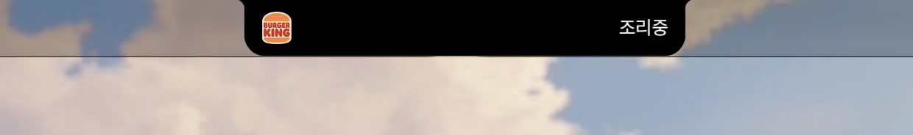
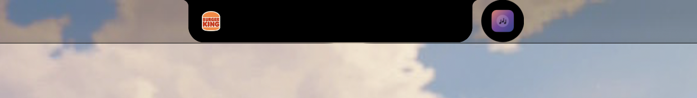
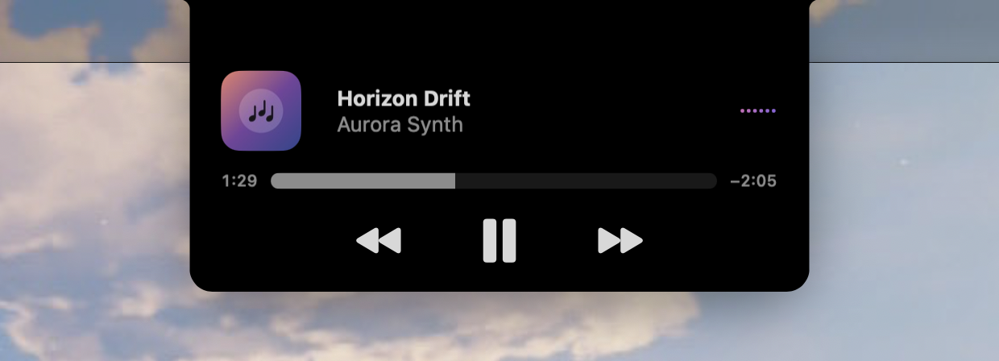
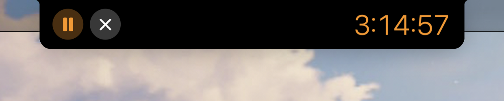
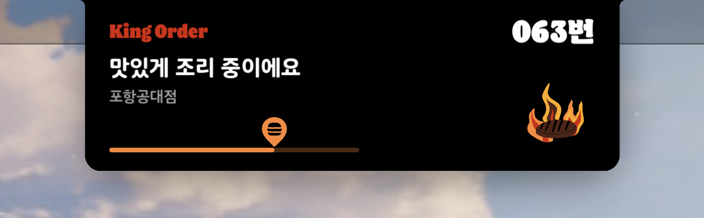
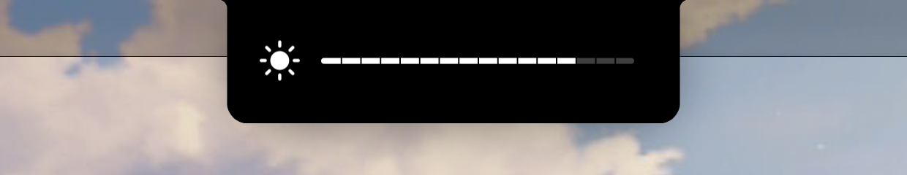

# MacIsland Notch

Enable Apple’s native Dynamic Island and adapt it to a MacBook’s physical notch. MacIsland Notch patches `MenuBarAgent` and stock HUD providers in memory—with outward-rounded shoulders, proper camera clearance, and full native restoration on external monitors—without adding a separate overlay app or modifying system binaries.

## Supported features

### Compact Notch & Dual-Activity Mitosis

Adapts Apple’s native `CenterHUD` around the physical camera housing while preserving Apple’s liquid mitosis and absorption spring transitions when a second background activity splits out (`noObstruction`) or merges back in.

<p align="center">
  
  <br />
  
</p>

### Now Playing (`MediaRemoteUIService`)

Keeps Apple’s native controls and artwork while aligning album art, metadata, audio waveform, and scrubber cleanly around and below the camera cutout.

<p align="center">
  
</p>

### Clock (`ClockAngel`)

Widens expanded Timer, Alarm, and Stopwatch platters (`522pt`) so dual controls and multi-hour `H:MM:SS` countdowns fit without clipping.

<p align="center">
  
</p>

### Live Activities & iPhone Continuity (`ActivityUIServices`)

Upgrades shrunken floating-pill Live Activities to full notched width (`470pt` at `1.0x` scale) on the built-in display while restoring stock geometry on external displays.

<p align="center">
  
</p>

### System HUDs, AirDrop & Hosted Notifications

Preserves native widths for Volume/Brightness HUDs (`309pt`), fixes hosted AirPods notification geometry, and keeps `AirDropUI` incoming share cards snug (`274pt`) with top previews pushed below the camera cutout.

<p align="center">
  
</p>

### Multi-Display Spotlight (`Campo` / `Siri AI`)

Uses Apple’s hardware Dynamic Island path on displays with a notch while keeping Spotlight detached and normal on external monitors.

## Requirements

- Apple Silicon MacBook with a notch
- **macOS 27.3 beta, build `26C5035r` or `26C5047e`** (other builds are rejected by default; set `MACISLAND_ALLOW_UNVERIFIED_BUILD=1` to opt in on an unverified build)
- Xcode / Apple developer tools with arm64e Swift compiler and macOS 27.2 SDK or later
- SIP disabled (`amfi_get_out_of_my_way=0x1` is **not** required)

## Install

Run as your normal user (**without `sudo`**):

```bash
curl -fsSL https://raw.githubusercontent.com/aloedawn/MacIsland-Notch/main/install.sh | bash
```

The installer builds and signs the patch locally under `~/Library/MacIsland`, backs up existing MacIsland files and the three affected preferences, reloads `MenuBarAgent` (plus any running providers), and registers `com.macisland.loader` to keep everything active across logins and process restarts.

To test on an unverified macOS build (relying on runtime structural checks and the loader's 3-per-15-minute reapply cap):

```bash
curl -fsSL https://raw.githubusercontent.com/aloedawn/MacIsland-Notch/main/install.sh | MACISLAND_ALLOW_UNVERIFIED_BUILD=1 bash
```

## Usage & Removal

Check loader status or manually reapply provider layouts:

```bash
/usr/bin/python3 ~/Library/MacIsland/loader.py --status
/usr/bin/python3 ~/Library/MacIsland/loader.py --providers-only
```

Verify the local build without installing or changing preferences:

```bash
curl -fsSL https://raw.githubusercontent.com/aloedawn/MacIsland-Notch/main/install.sh | bash -s -- --check
```

Uninstall and restore original files and preferences (keeps unrelated settings intact):

```bash
curl -fsSL https://raw.githubusercontent.com/aloedawn/MacIsland-Notch/main/install.sh | bash -s -- --uninstall
```

## Development

Sources live under `src/` (`island/`, `providers/`, `loader/`, `installer/`) and bundle into `install.sh`:

```bash
python3 scripts/build_installer.py
python3 scripts/build_installer.py --check
python3 -m unittest discover -s tests
```

## Credits

Based on [MakrSas/MacIsland](https://github.com/MakrSas/MacIsland/tree/a54047f69eceb4eaabd4f80034166fe23c8a0e7e) (`a54047f69eceb4eaabd4f80034166fe23c8a0e7e`) with upstream native discovery credited to [@itspdfu](https://x.com/itspdfu). Not affiliated with Apple. Loader safety and NSScreen signature checks were informed by [mtaipan/MacIsland](https://github.com/mtaipan/MacIsland/commit/918774cd924bd8192346932299e1b96b66a177ab) and [lovefromrimu/Notch2Island](https://github.com/lovefromrimu/Notch2Island).
