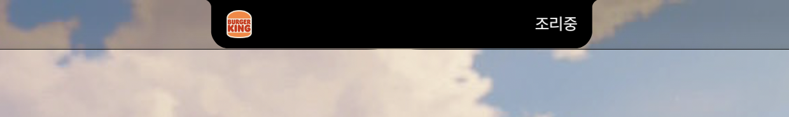
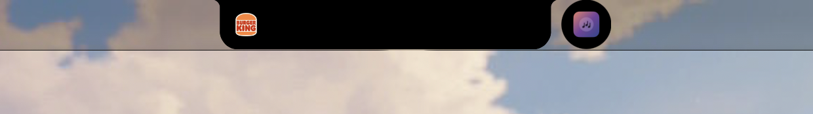
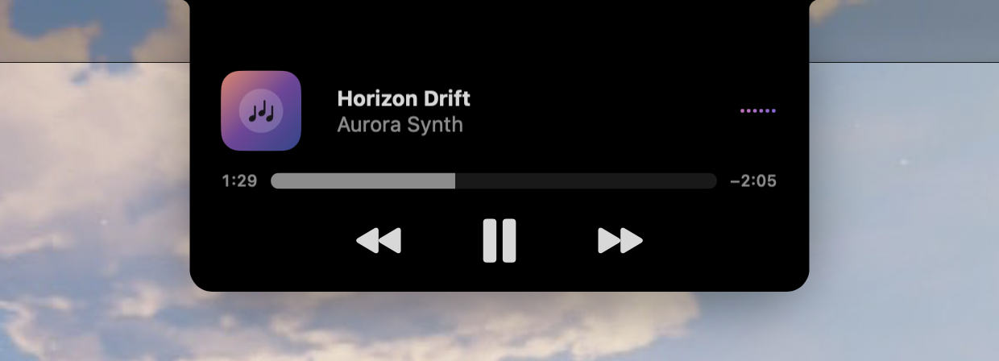
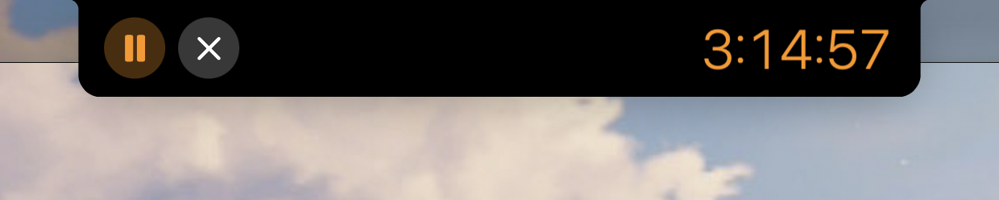
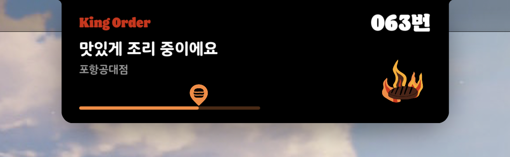
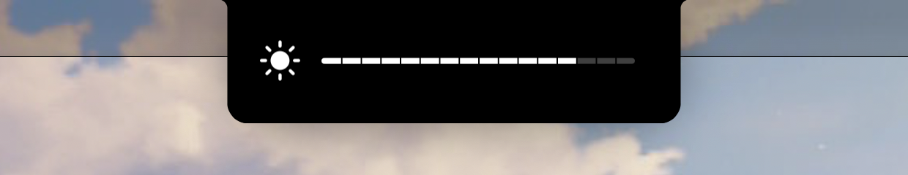

# MacIsland Notch

Enable Apple’s native Dynamic Island and adapt its background to a MacBook’s physical notch. This is the working native MenuBarAgent patch, including notch geometry, shared layout margins, outward-rounded shoulders, animated vector corners, and the one-pixel shrink-back correction. It does not add a separate island app or overlay.

## Supported features

### Compact Notch & Dual-Activity Mitosis

Adapts Apple’s native `CenterHUD` container to the MacBook’s physical camera housing with outward-rounded vector shoulders, scaled-display subpixel height compensation, and native spring-driven mitosis when a second background activity splits into or merges back from its detached circular `noObstruction` bubble.

<p align="center">
  
  <br />
  
</p>

### Now Playing (`MediaRemoteUIService`)

Re-aligns Apple’s native `NowPlayingUI` expanded platter around the notch without replacing controls or artwork views: album art sits in the left wing with a `12pt` clearance from the camera housing, track/artist metadata and the live audio waveform center vertically on the artwork, and the scrubber leading/trailing edges align with the artwork and waveform.

<p align="center">
  
</p>

### Clock — Timer, Alarm & Stopwatch (`ClockAngel`)

Widens `ClockAngel`’s `IntegratedViewGroup_V1` expanded hosts (`TimerHost`, `AlarmHost`, and `StopwatchHost`) from the stock `260pt` cap to `522pt` (`150pt` per wing around a `222×40pt` canonical cutout), placing dual `84×38pt` controls in the left wing and preserving a `120pt` centered-baseline right-wing budget so multi-hour `H:MM:SS` timers, snoozed alarms, and stopwatches fit cleanly.

<p align="center">
  
</p>

### Live Activities & iPhone Continuity (`ActivityUIServices`)

Rewrites `SystemApertureMetricsRequest` archives at the `FBSSceneSettings` boundary from `MenuBarAgent`’s floating-pill `374pt @ 0.80x` (`299.2pt` scaled) request to full notched wing width (`470pt` at crisp `1.0x` scale inside a `540pt` container ceiling), keeping `chronod` archive hashes consistent across compact, minimal, and expanded roles while restoring stock dimensions on external displays.

<p align="center">
  
</p>

### System HUDs & Hosted Notifications

Preserves native requested widths (`309pt` for Volume and Brightness) and corrects hosted-obstruction geometry for system HUD banners and device notifications such as AirPods automatic switching.

<p align="center">
  
</p>

### Multi-Display Spotlight (`Campo` / `Siri AI`)

Selects Apple’s hardware Dynamic Island path (`CampoDeviceSupportsCenterHUD() == true`) in-memory inside `Siri AI` so Spotlight grows out of the notch only on displays where `MenuBarAgent` configured a cutout, while opening detached as ordinary Spotlight on external monitors without a notch.

## Requirements

- Apple Silicon MacBook with a notch.
- **macOS 27.3 beta, build `26C5035r`**. Other builds are rejected.
- Apple developer tools with an arm64e Swift compiler and the macOS 27.2 SDK or later, plus an active desktop login.
- SIP already disabled. The broad `amfi_get_out_of_my_way=0x1` boot argument is **not required**. SIP being disabled still reduces macOS protections; the installer does not change SIP or boot arguments.

## Install

Run as your normal user, **without sudo**:

```bash
curl -fsSL https://raw.githubusercontent.com/aloedawn/MacIsland-Notch/main/install.sh | bash
```

The installer contains all source, builds and signs the patch locally, saves existing MacIsland files and the three affected preferences, then reloads MenuBarAgent. It installs to `~/Library/MacIsland` and reuses `com.macisland.loader` for login injection. Existing MacIsland installations are supported; the original backup is retained across reinstalls. If an upgrade of an existing MacIsland Notch installation fails, the previously installed version is put back; only a failed first installation returns to the original pre-install state.

After successful installation, an already-running Siri AI is reloaded once so Spotlight re-reads the island configuration and connects to MenuBarAgent. This dismisses its current UI. Inside Siri AI the loader also sets the cached answer of Campo's `CampoDeviceSupportsCenterHUD()` to true. This selects Apple's own Dynamic Island hardware path: Spotlight grows out of a display only when MenuBarAgent configured a cutout for it, and on any other display, such as an external monitor, it comes up detached as ordinary Spotlight. Without it, Campo treats a notched Mac as a simulator, assumes a cutout on every display, and abandons the search when the menu bar refuses an external one. Global MobileGestalt answers are not changed and no Spotlight methods are replaced. A stopped Siri AI is left stopped, and periodic checks reapply the patch to new Siri AI processes. A reload failure is reported without rolling back the installed island.

Preference backup and restoration use Foundation through the system JavaScript for Automation runtime. MenuBarAgent's app-group container is addressed explicitly, and backup records only the three affected persisted keys. Inherited defaults and unrelated values do not enter the backup. Existing snapshots are preserved, including any values an older installer recorded.

With the AMFI-disable flag absent, the loader requests a suspended MenuBarAgent launch, briefly attaches the system LLDB, and detaches to resume it. It verifies that `island.dylib` is mapped in the new process; a running PID alone is not treated as success. The launch environment is restored immediately after spawning the process. On debugger or load failure, the loader terminates the suspended instance and requests a normal restart. It refuses to restart MenuBarAgent while another debugger is attached.

Existing boots with `amfi_get_out_of_my_way=1` or `=0x1` retain the legacy loading path. That flag can prevent Karabiner's DriverKit extension from loading; this installer does not remove it or reboot the Mac. If removing it separately, preserve any unrelated boot arguments and restart before testing.

The loader attaches briefly to Apple’s MediaRemoteUIService and to ClockAngel when it is running. It checks the expanded music and timer layouts before restarting MenuBarAgent. Both provider layouts are optional. If a provider is busy or unavailable, the island itself still loads. The loader checks the OS build before applying any patch. No debugger remains running after injection. Logs are `~/Library/MacIsland/loader.log` and `loader-error.log`.

`com.macisland.loader` runs at login and then every 30 seconds with `--ensure`. Each run compares the current MenuBarAgent, MediaRemoteUIService, ClockAngel, and Siri AI instances (PID and start time) with the ones last patched. Restarted providers get their layouts back without restarting MenuBarAgent. To stop a crash loop, each component gets at most 3 automatic attempts per 15 minutes; after that, automatic reapplication pauses and the pause is logged. Running the loader manually resets the budget.

Inspect the current boot and selected strategy without reloading anything. The report compares current process identities with the loader's records; confirm visible HUD behavior on screen:

```bash
/usr/bin/python3 ~/Library/MacIsland/loader.py --status
```

Reapply only the provider layouts (Music and any running Clock or Spotlight instances), without restarting MenuBarAgent (`--music-only` is kept as an alias):

```bash
/usr/bin/python3 ~/Library/MacIsland/loader.py --providers-only
```

Build without installing or changing preferences:

```bash
curl -fsSL https://raw.githubusercontent.com/aloedawn/MacIsland-Notch/main/install.sh | bash -s -- --check
```

## Source layout

Sources are organized per subsystem under `src/` and bundled into the self-contained root `install.sh` by `scripts/build_installer.py`:

- `src/island/` — `MenuBarAgent` interposer (`island.dylib`): `notch-layout.h`, `island.c`, `notch.m`, `short-host.m`, `safearea.m`, `mask.m`
- `src/providers/` — UI provider patches (`notch-music.dylib`): `provider-abi.c`, `provider-body.S`, `witness.swift`, `music.swift`, `music-layout.swift`, `clock.swift`, `spotlight.m`
- `src/loader/loader.py` — process-scoped LLDB / legacy loader and periodic `--ensure` daemon
- `src/installer/` — `preferences.js`, `manager.py`, and shell template `runner.sh`
- `scripts/` — `build_installer.py` (bundle generator/checker) and `audit_island.py` (opt-in `FBSSceneSettings` layout diagnostics)

After editing files under `src/`, regenerate and verify `install.sh`:

```bash
python3 scripts/build_installer.py
python3 scripts/build_installer.py --check
```

## Remove

```bash
curl -fsSL https://raw.githubusercontent.com/aloedawn/MacIsland-Notch/main/install.sh | bash -s -- --uninstall
```

Restores the files and preference values saved before the first install, including an existing MacIsland installation. It preserves unrelated files and settings. A small `~/Library/MacIsland/installer.lock` file remains so concurrent installer runs keep sharing the same lock. Keep `~/Library/MacIsland/notch-backup` until removal. Removal stops the periodic check first, also works after an OS update, and does not re-enable SIP or AMFI.

## Scope and validation

The native implementation changes NSScreen’s CenterHUD geometry, both shared FBS scene-layout families, and the existing native background masks. Vector paths update within native presentation-modifier transactions; no independent enlargement animation, black filler, extra visual sibling, or system-binary replacement is added.

The loader checks that the installation directory and the library it will inject are owned by the current user and are neither symlinks nor writable by other users. The MenuBarAgent patch checks the executable's full system path before activating. The three NSScreen geometry hooks are installed only if their Objective-C signatures match `NSScreen.frame`.

Tested on a notched MacBook running `26C5035r`, with music visible and user confirmation of the hover/shrink-back outline correction. The click-dismiss/hover shrink-back top-gap regression was also user-confirmed resolved after pairing native background modifier publication with the vector-mask transaction, preserving target times. The separate hosted-obstruction transport is also corrected; the user confirmed normal text and imagery in the AirPods automatic-switching notification. A real reboot with empty boot arguments and SIP still disabled verified automatic patch loading, healthy Karabiner virtual HID readiness, and user-confirmed Dynamic Island display. This establishes coexistence on the tested machine; it does not prove that debugger attachment is necessary on every startup. That reboot predates the music layout and the periodic reapplication; a reboot with the current version has not yet been verified. Local native regression checks covered modifier capacity, vector curves, pixel alignment, repeat-safe layout updates, and restoration. Full provider coverage is not established: some expanded AirDrop artwork/icons may still enter the physical notch; a complete provider-root safe-area remap remains unfinished. Other Macs, OS builds, and all transient UI states are unverified.

The primary background and its detached circle publish their geometry through the native merge transaction at the original target time. Refreshing the primary mask preserves the spring velocity. Where Apple's existing opaque material can draw the outward shoulder, the filtered input supplies the body and the bridge to the circle. An offscreen Metal comparison and two live open/dismiss cycles exercised this path on the tested Mac.

During absorption, the filtered circle and its matching native background layers stop painting before they protrude into the main contour. The original detached background takes over when the circle separates. On the tested Mac with music in the right-hand slot, the sampled frames showed no outline protrusion or flicker when opening and closing either activity. The expanded panel also displayed a test track with a title and no artist below the physical notch.

Expanded activity scenes (`elementView`) preserve side-wing clearance around the physical notch (`notchWidth + 164` floor — 384 points on a 220-point notch — with a `notchWidth + 320` maximum ceiling, 540 points on a 220-point notch) while keeping Apple's wing-based `BaselineRow` / obstruction geometry intact; detached secondary minimal islands (`noObstruction`) remain unpatched. To prevent `MenuBarAgent` from clipping wider expanded platters to its iPhone System Aperture `408pt` container cap (`Settings.hostedSceneMetrics.maximumContentWidth`), `island.dylib` registers `HostedSceneMetricsMaximumContentWidth` (`notchWidth + 320`) in `NSRegistrationDomain` purely in-memory while a notched display is active, triggering `SystemSettingsController`'s KVO reload without writing any persistent disk preferences and automatically restoring `408pt` in clamshell / external-only display configurations. General third-party and iPhone Continuity Live Activities (`ActivityUIServices` / `WidgetRenderer_Activities`) also have their `SystemApertureMetricsRequest` rewritten at the `FBSSceneSettings` boundary from `MenuBarAgent`'s floating-pill `374pt @ 0.80x` (`299.2pt` scaled) archive request to full notched wing width (`obstructionWidth + 248` — `470pt` at crisp `1.0x` scale around a `222×40pt` canonical cutout, preserving `104pt` usable wing capacity per side inside Jindo's `20pt` insets) with unified `chronod` archive hashes across compact, minimal, and expanded roles and full native restoration on external non-notched displays. ClockAngel's expanded Timer, Alarm, and Stopwatch `IntegratedViewGroup_V1` hosts read `IntegratedObstruction_V1` directly to widen their scene frame to 522 points (150 points per wing around a 222-point canonical cutout, preserving a 120-point right-wing `BaselineRow` budget for multi-hour `H:MM:SS` timers), resolve `BaselineRow` across `_VariadicView.Tree` wrappers, and propagate the host cutout size on frame 0 before geometry-driven obstruction state settles. Hosted system banners such as the volume and brightness HUD keep the width they request themselves (309 points for volume). The expanded music panel uses Apple’s original artwork, text, waveform, timeline, and controls. As on iPhone, the artwork shares the timeline's leading edge and the waveform its trailing edge; the panel is sized so the artwork sits in the left wing with a 12-point clearance from the camera housing, and the title/artist metadata and waveform are centered vertically on the artwork below the cutout. The outgoing panel retains this layout when its native mode changes to compact during dismissal. The native compact island allocates a trailing music slot when music is the sole activity. With two activities, the second activity occupies its own slot.

The scene-layout accessors (margins, minimum size, obstruction) only appear on `FBSSceneSettings` once FrontBoardServices registers their settings extensions, which Apple does lazily for the first expanded or hosted scene. The patch registers the known extensions itself and re-verifies its hooks after every extension registration, so a late first expansion still receives the notch layout instead of the native pill width.

In scaled display modes, points do not land on whole panel pixels: a 3024-pixel panel shown at 1800 points maps the 38-point safe area to 63.84 physical rows, while the camera housing covers 64. The island background extends by the remaining fraction (about 0.1 point there), computed from the display's native mode; at the default 1512-point mode no extension is added.

The embedded loader and installer have regression checks for AMFI-enabled strategy selection, the OS build gate, preserving the prior launch environment, refusing an already-debugged process, verifying the actual library mapping, recovering from debugger/load failure, loading the island when the music layout fails, waiting for a slow music provider, periodic reapplication and its restart-loop limit, and returning to the previous version after a failed upgrade:

```bash
python3 -m unittest discover -s tests
```

## Credits

Based on [MakrSas/MacIsland](https://github.com/MakrSas/MacIsland/tree/a54047f69eceb4eaabd4f80034166fe23c8a0e7e), commit `a54047f69eceb4eaabd4f80034166fe23c8a0e7e`. Native feature discovery credited upstream to [@itspdfu](https://x.com/itspdfu). The interposer, loader, and notch adaptations are included as readable source in `install.sh`. The pinned upstream revision has no license file; no additional upstream license is asserted here. Not affiliated with Apple.

The loader file checks and executable path check were informed by [mtaipan/MacIsland](https://github.com/mtaipan/MacIsland/commit/918774cd924bd8192346932299e1b96b66a177ab). The NSScreen signature check and the distinction between recorded process state and visible HUD behavior were informed by [lovefromrimu/Notch2Island](https://github.com/lovefromrimu/Notch2Island).
